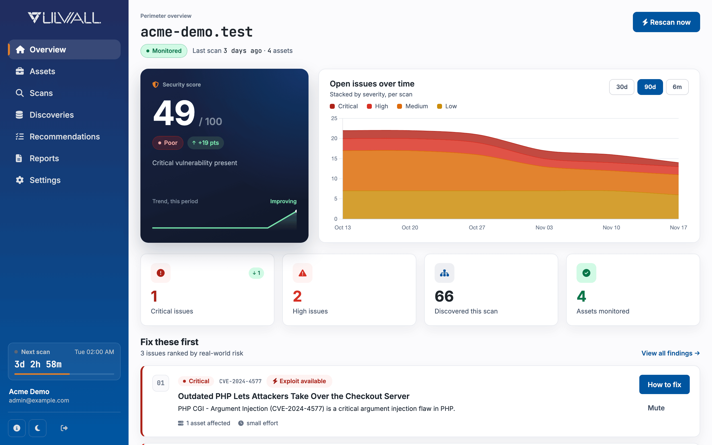
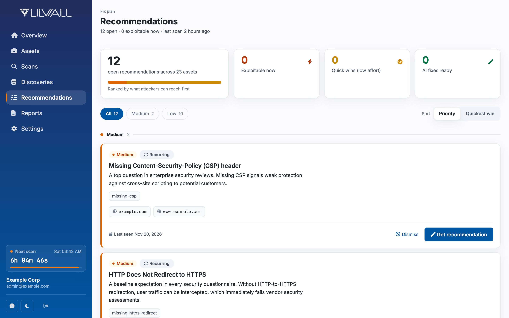
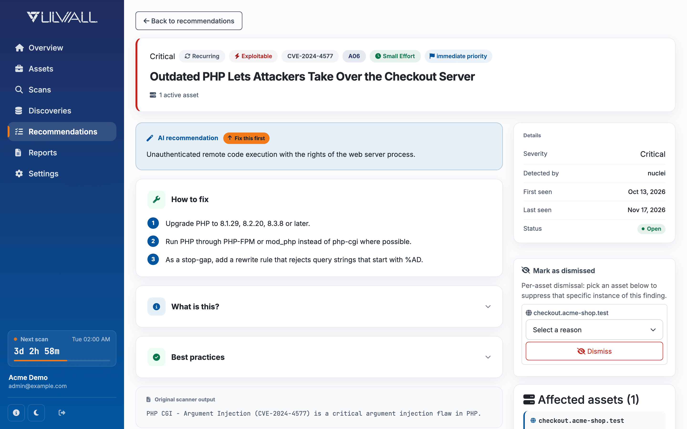
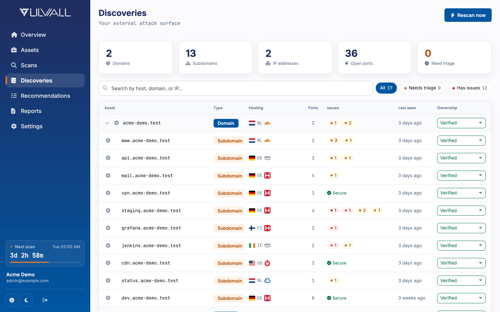
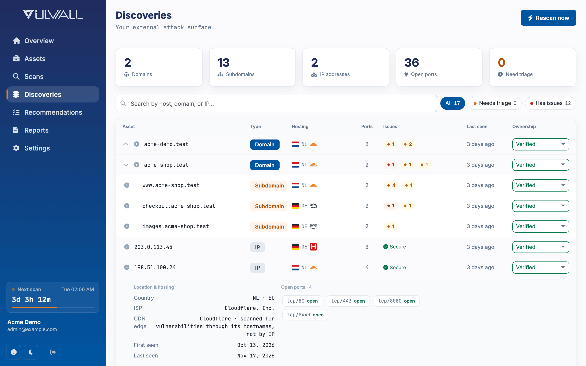
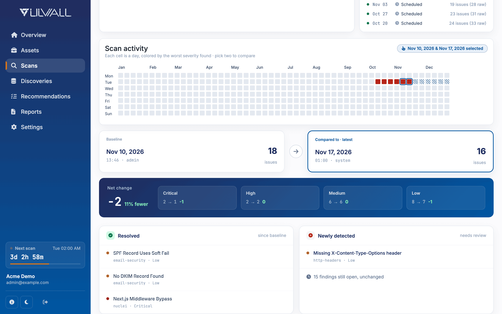
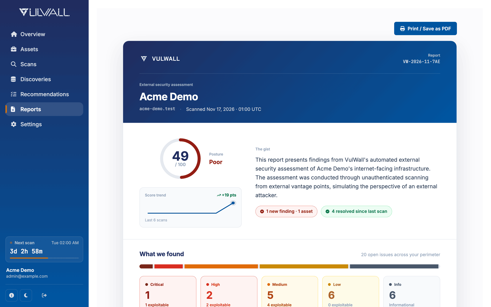
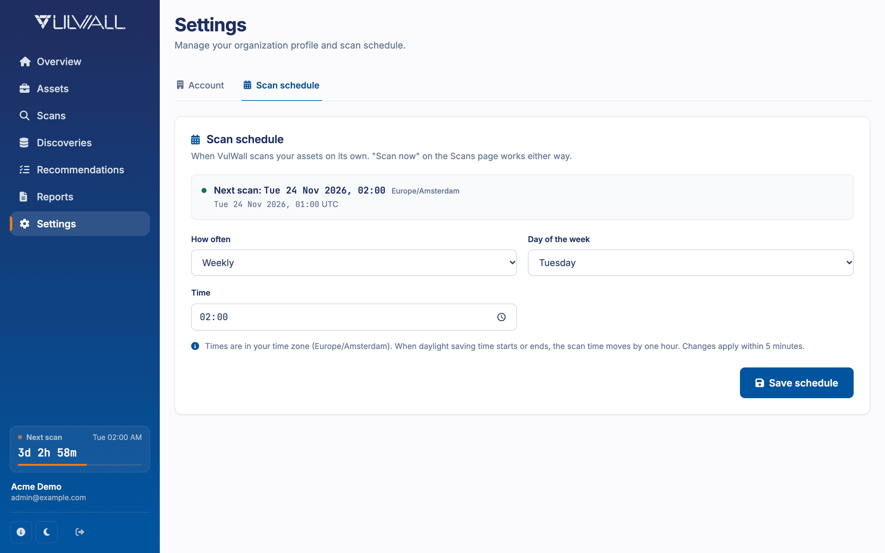
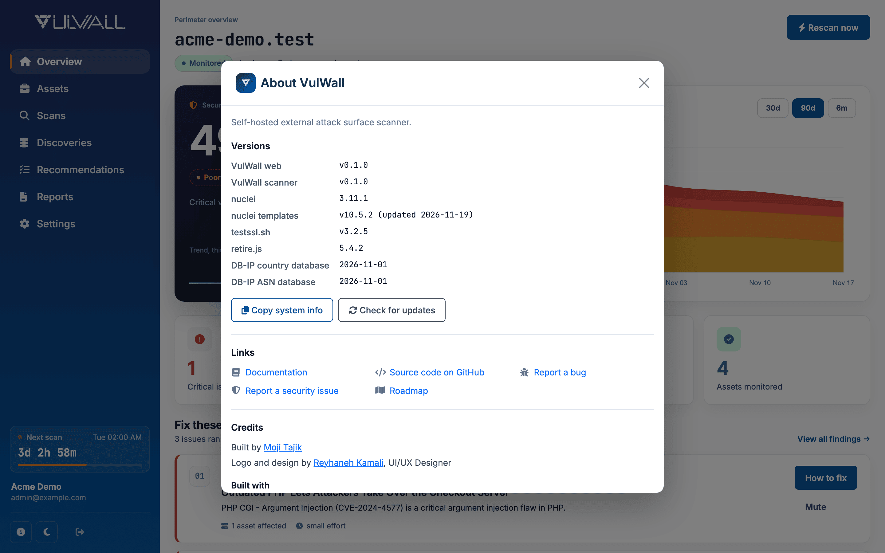

# VulWall

VulWall is a self-hosted security scanner for small and medium businesses. You
give it your domains and IP addresses. It finds your external attack surface
(subdomains, IPs, open ports), scans it for vulnerabilities on a schedule, and
shows the results in a web dashboard with plain-language explanations of what
to fix.

<picture>
  <source media="(prefers-color-scheme: dark)" srcset="docs/screenshots/overview-dark.png">
  
</picture>

| | |
|---|---|
| [](docs/screenshots/findings-light.png) | [](docs/screenshots/finding-detail-light.png) |
| **Recommendations** ([dark](docs/screenshots/findings-dark.png)) | **Issue detail** ([dark](docs/screenshots/finding-detail-dark.png)) |
| [](docs/screenshots/discoveries-light.png) | [](docs/screenshots/discoveries-cdn-edge-light.png) |
| **Discoveries** ([dark](docs/screenshots/discoveries-dark.png)) | **CDN edge address** ([dark](docs/screenshots/discoveries-cdn-edge-dark.png)) |
| [](docs/screenshots/scans-light.png) | [](docs/screenshots/report-light.png) |
| **Scans** ([dark](docs/screenshots/scans-dark.png)) | **Summary report** ([dark](docs/screenshots/report-dark.png)) |
| [](docs/screenshots/settings-schedule-light.png) | [](docs/screenshots/about-light.png) |
| **Scan schedule** ([dark](docs/screenshots/settings-schedule-dark.png)) | **About** ([dark](docs/screenshots/about-dark.png)) |

Screenshots show sample data (see [Demo data](#demo-data)): the fictional
company "Acme Demo" on reserved `.test` domains and documentation IP addresses.
The findings use the real texts of the scanners.

## Features

- Finds subdomains (with subfinder), resolves them and scans TCP ports on
  your domains and IP addresses.
- Scans for vulnerabilities with:
  - [nuclei](https://github.com/projectdiscovery/nuclei) templates for CVEs,
    exposures, misconfigurations, default logins and takeovers. Intrusive and
    DoS templates are excluded by default.
  - [testssl.sh](https://testssl.sh) for TLS/SSL weaknesses
  - [retire.js](https://retirejs.github.io/retire.js/) for outdated
    JavaScript libraries
  - its own checks for missing or weak HTTP security headers, for SPF,
    DMARC and DKIM, and for TLS certificates that expire soon
- Detects WAFs and cloud providers, and looks up the country and network
  owner of each IP with the free DB-IP Lite data.
- The dashboard shows assets, scan history, discoveries, findings and
  reports. Each finding comes with the scanner's own description and,
  when the scanner provides them, remediation advice and references.
- With an AI provider API key (Anthropic for now), VulWall also writes business and technical
  remediation guidance for each finding type, and executive summaries. This
  is optional.
- Scans run on the schedule you set in Settings → Scan schedule. Until you
  change it, VulWall scans once a week at a random time at night, and a
  change applies within 5 minutes. You can also start a scan from the UI at
  any time.
- Everything runs from one `docker compose up` with no external services.
  OpenTelemetry tracing is available but off by default.

## Quick start

You need a Linux or macOS host with 4 GB of RAM (recommended) and Docker
with Compose v2. In a test scan of one domain with the default settings, the
stack used up to 1.5 GB, of which the scanner used 1.2 GB. More domains and a
higher `NUCLEI_WORKERS` use more. The CPU must be 64-bit and able to run
MongoDB: AVX on x86-64, ARMv8.2-A on ARM (a Raspberry Pi 5 works, a Pi 4 does
not).

```bash
curl -fsSL https://vulwall.com/install.sh | sh
```

The script checks the host, installs the latest release into `~/vulwall`,
verifies the downloaded files, adds a random first-run setup token to `.env`,
starts the stack and prints the setup link. If port 8080 is taken, it picks a
free port from 8081 to 8099. On Linux without Docker, it offers to install
Docker with Docker's official script; it uses `sudo` only for that, and only
after you say yes. Run it again to upgrade. See the
[documentation](https://vulwall.com/docs) for options.

The script also installs the `vulwall` command for day-to-day tasks:

```bash
~/vulwall/vulwall status       # containers, health and URL
~/vulwall/vulwall backup       # back up the database and .env
~/vulwall/vulwall upgrade      # upgrade to the latest release
~/vulwall/vulwall doctor       # check the host and the scanner's internet access
~/vulwall/vulwall help         # all commands
```

Or install from a clone of this repository:

```bash
git clone https://github.com/VulWall/VulWall.git && cd VulWall
cp .env.example .env        # optional: set AI_API_KEY
echo "SETUP_TOKEN=$(openssl rand -hex 16)" >> .env
docker compose up -d
```

Open `http://localhost:8080/setup?token=<token>` with the token from
`grep SETUP_TOKEN .env` (if you changed `VULWALL_PORT`, use your port). The
token protects setup: without it, `/setup` returns 404. Create the admin
account, add a domain you own, then start a scan.

Without `SETUP_TOKEN`, the web container makes a new random token at each start
and prints the link in its log. Print it with this command, which shows only the
real link line and strips control characters:

```bash
docker compose logs --no-log-prefix web | grep -a '^ *First-run setup: open http://localhost:[0-9]*/setup?token=[0-9a-f]* ' | tail -1 | tr -cd '[:print:]\n'
```

The web UI listens on `127.0.0.1` only. To use it from another machine, see
[Exposing VulWall](#exposing-vulwall).

The first start takes a few minutes: the scanner downloads the nuclei
templates and the geolocation databases. `docker compose logs -f scanner`
shows progress.

## Demo data

To try the dashboard without scanning anything, load the sample data that the
screenshots use:

```bash
make demo
```

This builds the images, starts MongoDB, Redis and the web app (not the
scanner), and runs `scripts/demo-seed`. Then open the setup link (see
[Quick start](#quick-start)) and create the admin account. If you type an
organization name at setup, run `scripts/demo-seed` again to name it "Acme
Demo" again.

The sample data is the fictional company "Acme Demo": two root domains and
13 subdomains under the reserved `.test` top-level domain, two IP assets,
addresses only from the documentation ranges (`192.0.2.0/24`,
`198.51.100.0/24`, `203.0.113.0/24`), six weekly scans over the last six
weeks, findings from every scanner (with the scanners' real titles,
descriptions and references), one accepted risk, one false positive and
sample knowledge-base entries for four finding types (as the optional AI
engine would write them). Every
document it inserts has `demo: true`; the organization is renamed, and its own
name, schedule and tour state are kept for `--reset`.

```bash
scripts/demo-seed           # load; refuses if you already have assets or findings
scripts/demo-seed --force   # load next to your own data
scripts/demo-seed --reset   # remove the sample data, restore the organization's name and schedule
```

`scripts/demo-seed` runs the `demo-seed` program from the scanner image
(`docker compose run --rm --no-deps --entrypoint demo-seed scanner`), so MongoDB
must be running. In an installed release (v0.1.0 or later), run that command
in `~/vulwall`.

Keep the scanner stopped while you show the sample data. A real scan of the
`.test` names finds nothing, and the dashboard always shows the newest scan.

## Configuration

All settings are optional and go in `.env`. `.env.example` lists them with
comments.

| Variable | Default | Purpose |
|----------|---------|---------|
| `AI_API_KEY` | empty | Enables AI remediation guidance and executive summaries |
| `AI_PROVIDER` | `anthropic` | AI provider; only `anthropic` for now |
| `AI_MODEL` | `claude-sonnet-5-5` | Model for AI remediation guidance and executive summaries |
| `AI_BASE_URL` | empty | Gateway or proxy in front of the provider's API. https, or http to a local host only |
| `VULWALL_PORT` | `8080` | Host port of the web UI (bound to `127.0.0.1`) |
| `SETUP_TOKEN` | empty | First-run setup token. The install script sets a random one; empty means a new random token at each start, printed in the log |
| `VULWALL_VERSION` | `latest` | Image tag of `ghcr.io/vulwall/scanner` and `ghcr.io/vulwall/web` |
| `VULWALL_BUILD_VERSION` | `dev` | Version that images built from source show in the About dialog. `make build` and `make up` set it to `dev (<short commit>)` |
| `SECURE_COOKIES` | `false` | Set to `true` when VulWall is served over HTTPS |
| `UPDATE_CHECK` | `true` | Ask the GitHub API for the latest release shortly after start, then every 6 hours (sooner after a failed check: 15 minutes, doubling up to 6 hours), and show a dot on the About button when one is newer. `false` turns it off; a value other than `true`, `1`, `yes`, `on`, `false`, `0`, `no` or `off` also turns it off, with a warning in the log |
| `TRUSTED_PROXIES` | empty | IPs/CIDRs of reverse proxies whose `X-Forwarded-*` headers are trusted |
| `NUCLEI_WORKERS` | `2` | Concurrent nuclei processes |
| `NUCLEI_RATE_LIMIT` | `30` | Requests per second for each nuclei process |
| `NUCLEI_INTERACTSH` | `off` | `on` runs nuclei's out-of-band (OAST) checks. Vulnerable targets then call back to ProjectDiscovery's public interactsh servers unless you set your own |
| `NUCLEI_INTERACTSH_SERVER` | empty | https URL of your own interactsh server |
| `NUCLEI_INTERACTSH_TOKEN` | empty | Auth token of that server |
| `NUCLEI_TEMPLATE_UPDATE_CRON` | `0 2 * * *` | When nuclei updates its templates: 5-field cron, UTC (daily at 02:00) |
| `NUCLEI_INCLUDE_TAGS` | `cve,vuln,exposure,misconfig,...` | nuclei template tags to run (full list in `.env.example`) |
| `NUCLEI_EXCLUDE_TAGS` | `intrusive,dos,fuzz` | nuclei template tags to skip. Removing these makes scans intrusive: attack payloads and floods that can change or take down the sites you scan |
| `TESTSSL_CONCURRENCY` | `5` | Concurrent testssl.sh scans |
| `CERT_EXPIRY_WARN_DAYS` | `30` | A TLS certificate that expires within this many days is a medium finding |
| `CERT_EXPIRY_CRITICAL_DAYS` | `7` | Within this many days, or expired, it is a high finding |
| `DNS_RESOLVE_CONCURRENCY` | `50` | Concurrent DNS lookups when domain discovery resolves subdomains |
| `DNS_RECHECK_RESOLVERS` | `1.1.1.1,8.8.8.8` | Public resolvers asked when the local resolver says a name does not exist; `off` stops these lookups |
| `ALLOW_PRIVATE_TARGETS` | `false` | Allow scanning private/internal IP ranges |
| `GEO_DOWNLOAD` | `true` | Download DB-IP Lite databases on start |
| `GEO_MAX_AGE_DAYS` | `35` | Days before those databases are downloaded again |
| `CLOUD_DETECTOR_ENABLED` | `true` | Label AWS, Azure, GCP and Fastly addresses (downloads their IP ranges on start) |
| `OTEL_ENABLED` | `false` | Export OpenTelemetry traces (see below) |
| `OTEL_EXPORTER_OTLP_ENDPOINT` | `http://jaeger:4318` | OTLP/HTTP endpoint |
| `OTEL_EXPORTER_OTLP_HEADERS` | empty | Headers for a hosted OTLP backend |
| `OTEL_TRACES_SAMPLER` / `OTEL_TRACES_SAMPLER_ARG` | `parentbased_always_on` / `0.1` | Trace sampler and the ratio for the probabilistic samplers |

### Exposing VulWall

VulWall serves plain HTTP on port 8080, and compose publishes it on
`127.0.0.1` only. To use it from other machines, put it behind a
TLS-terminating reverse proxy (Caddy, Traefik, nginx):

1. Run the proxy on the same host and point it at `http://127.0.0.1:8080`.
   If the proxy runs in Docker, add it to the `vulwall_default` network and
   point it at `http://web:8080` instead.
2. Set `SECURE_COOKIES=true` in `.env`.
3. Add the proxy's address, as VulWall sees it, to `TRUSTED_PROXIES`. For a
   proxy on the host this is the gateway of the `vulwall_default` network
   (`docker network inspect vulwall_default`); for a proxy container, it is
   that container's address on `vulwall_default`.
4. `docker compose up -d`.

Do not publish port 8080 on all interfaces (`"8080:8080"`) to get remote
access. Docker writes its own iptables rules, so ports it publishes bypass
host firewalls such as ufw and firewalld, and anyone who can reach the host
gets plain HTTP.

Login attempts are rate-limited per client IP (5 failed attempts per 15
minutes), and login also has a limit for the admin account (20 attempts per 15
minutes from all IPs). If `TRUSTED_PROXIES` does not match your
proxy, VulWall sees every request as coming from the proxy, so all clients
share one IP limit and a few wrong passwords lock everyone out.

### Tracing

```bash
echo "OTEL_ENABLED=true" >> .env
docker compose --profile tracing up -d
```

Jaeger runs at http://localhost:16686 (bound to `127.0.0.1`; traces include your hostnames and findings, so do not publish it). Any other OTLP backend works too; see
[scanner/docs/OBSERVABILITY.md](scanner/docs/OBSERVABILITY.md).

## Upgrading

With the install script: `~/vulwall/vulwall upgrade`, or run the script again.

From a clone:

```bash
git pull
docker compose pull          # when you use the published images
make up                      # when you build from source
```

Data lives in Docker volumes, so it survives upgrades. Read
[CHANGELOG.md](CHANGELOG.md) before you upgrade, and back up first.

Release images carry a signed build provenance attestation. To check that an
image was built from this repository by its release workflow:

```bash
gh attestation verify oci://ghcr.io/vulwall/web:0.1.0 --owner VulWall
```

See [Verify a release](https://vulwall.com/docs/operations/upgrade/#verify-a-release).

## Backup and restore

All application data is in MongoDB (volume `vulwall_mongo-data`). Redis only
holds work in progress, and the nuclei and geo volumes are downloaded again
when they are missing. The `vulwall_web-keys` volume holds the keys that sign
login cookies; if you lose it, you only have to log in again.

With the install script, `~/vulwall/vulwall backup` and
`~/vulwall/vulwall restore <file>` do the steps below.

Back up:

```bash
docker compose exec -T mongo mongodump --db vulwall --archive --gzip > vulwall-$(date +%F).archive.gz
```

Restore (this replaces the current data):

```bash
docker compose exec -T mongo mongorestore --drop --archive --gzip < vulwall-2026-01-31.archive.gz
```

## Lost admin password

VulWall has one admin account. To replace it, delete it and run the
first-run setup again. Your assets, scans and findings stay. With the install
script, `~/vulwall/vulwall reset-admin` does this and prints a new setup link.
Otherwise:

```bash
docker compose stop web
docker compose exec mongo mongosh vulwall --quiet --eval 'db.users.deleteOne({_id:"admin"})'
docker compose start web
grep SETUP_TOKEN .env
```

Open `http://localhost:8080/setup?token=<token>` with that token (use your
`VULWALL_PORT` if you changed it) and create the admin account again. If `.env`
has no `SETUP_TOKEN`, print the new link from the log instead:

```bash
docker compose logs --no-log-prefix web | grep -a '^ *First-run setup: open http://localhost:[0-9]*/setup?token=[0-9a-f]* ' | tail -1 | tr -cd '[:print:]\n'
```

## Scan only what you are allowed to scan

VulWall sends active network traffic: port scans, TLS handshakes and
vulnerability probes. Scanning systems without the owner's permission can be
illegal in your country, and it can break your hosting provider's terms of
service. Add only domains and IP addresses that you own or that you have
written permission to test. You alone are responsible for how you use VulWall.
The software comes with no warranty (see the license).

## Repository layout

| Path | What it is |
|------|------------|
| `scanner/` | Go scanning engine (the `nightwatch` binary). See [scanner/README.md](scanner/README.md). |
| `web/` | ASP.NET Core MVC dashboard. |
| `docker-compose.yml` | The self-hosted stack: MongoDB, Redis, scanner, web. |

## Roadmap

Planned work, each tracked in a GitHub issue:

- [Notifications for new findings (webhook, Slack/Discord/Teams, email)](https://github.com/VulWall/VulWall/issues/1)
- [Support OpenAI-compatible and local AI models (Ollama, LM Studio, vLLM)](https://github.com/VulWall/VulWall/issues/2)
- [Export findings (CSV/JSON) and a read-only API](https://github.com/VulWall/VulWall/issues/3)
- [Multiple users with admin and viewer roles](https://github.com/VulWall/VulWall/issues/4)
- [Scan profiles: light, standard, deep](https://github.com/VulWall/VulWall/issues/5)
- [Change common settings from the web UI (AI key, scanner tuning, DNS re-checks)](https://github.com/VulWall/VulWall/issues/6)
- [Optional asset import from DNS and cloud providers (Cloudflare, Route 53, Azure, AWS, GCP)](https://github.com/VulWall/VulWall/issues/7)
- [Ticket integration: Jira, GitHub Issues, GitLab Issues and Linear](https://github.com/VulWall/VulWall/issues/10)
- [Prioritize by real exploitability with CISA KEV and EPSS](https://github.com/VulWall/VulWall/issues/11)
- [Record scan authorization when adding assets](https://github.com/VulWall/VulWall/issues/12)
- [Compliance evidence: map findings to ISO 27001, NIS2 and SOC 2](https://github.com/VulWall/VulWall/issues/13)
- [Single sign-on with OpenID Connect](https://github.com/VulWall/VulWall/issues/14)
- [Run new nuclei templates on all assets right after an update](https://github.com/VulWall/VulWall/issues/15)
- [Easy setup for a self-hosted callback (interactsh) server](https://github.com/VulWall/VulWall/issues/18)
- [Run nuclei in batches instead of one process per target](https://github.com/VulWall/VulWall/issues/19)
- [Find secrets in public JavaScript and HTML](https://github.com/VulWall/VulWall/issues/20)
- [Business context on assets: owner, criticality, environment, tags](https://github.com/VulWall/VulWall/issues/21)
- [Retest a single finding](https://github.com/VulWall/VulWall/issues/22)
- [Scan on change: targeted scans when a host, port or technology changes](https://github.com/VulWall/VulWall/issues/23)
- [Detect exposed AI infrastructure (Ollama, MCP servers, vector databases)](https://github.com/VulWall/VulWall/issues/24)
- [Leaked credentials through Have I Been Pwned](https://github.com/VulWall/VulWall/issues/25)
- [Look-alike and phishing domain monitoring](https://github.com/VulWall/VulWall/issues/26)

### Ideas

These are not planned yet:

- [Check managed cloud services against CVEs and end-of-life dates](https://github.com/VulWall/VulWall/issues/8)
- [Scan container images and VMs for vulnerable packages](https://github.com/VulWall/VulWall/issues/9)
- [Workspaces for MSPs and consultants](https://github.com/VulWall/VulWall/issues/16)
- [MCP server for AI assistants](https://github.com/VulWall/VulWall/issues/17)
- [Suggest related domains and subsidiaries](https://github.com/VulWall/VulWall/issues/27)
- [Opt-in AI validation of a finding](https://github.com/VulWall/VulWall/issues/28)
- [LLM-drafted nuclei templates for new CVEs](https://github.com/VulWall/VulWall/issues/29)

## Contributing

See [CONTRIBUTING.md](CONTRIBUTING.md) and the
[Code of Conduct](CODE_OF_CONDUCT.md). Report security issues privately, as
described in [SECURITY.md](SECURITY.md).

## Credits

VulWall is built and maintained by [Moji](https://github.com/MojtabaTajik).
[Reyhaan](https://reyhane.pro/), UI/UX Designer, designed the logo,
the colour palette and the design system. VulWall runs on open-source tools
and data, listed with their licenses in [NOTICE](NOTICE).

## License

VulWall is released under the [MIT License](LICENSE).
Copyright (c) 2026 Moji Tajik.

Third-party tools and data bundled in the container images keep their own
licenses; see [NOTICE](NOTICE).

Trademarks: the VulWall name and logo are trademarks of Moji Tajik. The MIT
License covers the code only; it gives no right to use the VulWall name or
logo. If you distribute a modified version, give it a different name.

The logo and brand assets are © 2026 Moji Tajik, designed by Reyhaan
(https://reyhane.pro/), and are not covered by the MIT License. NOTICE lists
the files.

Source: https://github.com/VulWall/VulWall
